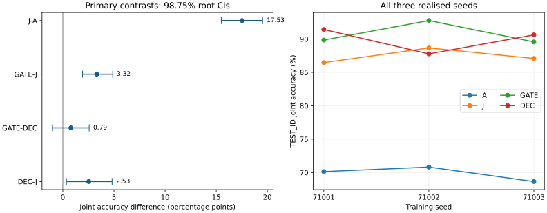

# SR-F1.2 最终中文报告

日期：2026-10-12（新加坡）。分析对象为冻结的四臂 × 三种子 × 96步及共同起点。

## 1. 结论与边界

联合事件训练明显改善了本任务的未见联合正确率。GATE 相对 J 提高 **3.32 个百分点**，四对比族校正后的98.75%区间为 **[1.93, 4.88]**；但 GATE 相对 DEC 仅 +0.79pp，区间 **[−1.01, 2.57]**，且三个种子方向不一致，**不能据此宣称分层奖励优于加法组合**。J 相对 A 的增益为17.53pp，DEC 相对 J 为2.53pp。

预登记预测没有形成一致支持：P1、P3方向相反；P2点估计方向符合但区间跨零。GATE首8步纯语义分支率的描述性机制核对在登记容差内，不能抵消预测失败，也不能证明“测量正确指导了训练”。

收益具有任务和协议边界：纯答案协议的准确率远低于证据协议；组合偏移上DEC优于GATE。ChartQA正式评分出现尾换行口径问题，必须同时阅读第7节及独立敏感性结果；不能把正式exact=0解释为模型不会回答，也不能据此认证外部能力保持。所有不利结果均保留。

## 2. 完成度、数据与验收

12条科学训练均完成96步，最终完整Adam/参数/调度器/cursor/RNG、adapter及FIT32/64/96由门禁验收；13个终点评价作业全部真实COMPLETED 0:0并离队。统一释放在新加坡2026-10-12 22:51:42完成，CPU198239正常结束；最终回执为`EVALUATIONS_COMPLETE_REPORT_PENDING`，共227,700条正式端点评价记录。该状态字面上仍表示报告待交付，本报告不改写服务器不可变回执。

| 面板 | 每模型记录数 | 边界 |
| --- | --- | --- |
| TEST_ID证据 | 8,192 | 128根×16题×4样本；主终点 |
| TEST_ID纯答案 | 4,096 | 相同题，独立协议K2 |
| 组合/语言/外观偏移 | 各512 | 各64根，证据协议K4；分别报告 |
| ChartQA | 2,500 | human/augmented各1,250；greedy |
| 五诊断视图 | 训练模型1,280；起点2,560 | 起点K8、终点K4；起点另有MONITOR4,096 |
| TRAIN_FIT | 每次128 | 训练模型32/64/96；共同起点一次 |

正式协议测量总量238,964 = 端点227,700 + 起点语义测量6,656 + 训练中FIT4,608。原表235,892漏计中间FIT3,072；**238,964不包括训练rollout**，12条训练另生成147,456条（12×96×128），技术试跑/预检/失败另记。

固定学习率5e−5、语言解码器全Linear LoRA r8/α16/dropout0、KL系数0.02、微批1、无checkpointing、每题8条batch生成、单次PG更新及detached TIS C=2。PART未选择。跨种子滚动填空及提前封存评价仅改变调度时刻，冻结科学设置未变。

## 3. 主终点与四项主对比

A表示答案正确，E表示证据集合契约正确，p_read为读取比例，P为证据与读取同时通过，J=A×P。下表百分比按题内样本→根内题→族内根→四族等权→三个种子等权；共同起点只生成一次，未伪装成三条独立重复。

| 模型 | A | E | p_read | P | J |
| --- | --- | --- | --- | --- | --- |
| 共同起点 | 48.41 | 68.48 | 92.66 | 61.87 | 31.70 |
| A | 91.96 | 76.88 | 92.54 | 76.45 | 69.87 |
| J | 88.26 | 99.02 | 99.52 | 98.60 | 87.40 |
| GATE | 91.24 | 99.52 | 99.74 | 99.17 | 90.72 |
| DEC | 90.27 | 99.85 | 99.76 | 99.09 | 89.93 |

| 臂 | seed71001 J | seed71002 J | seed71003 J | 均值 |
| --- | --- | --- | --- | --- |
| A | 70.14 | 70.83 | 68.65 | 69.87 |
| J | 86.46 | 88.66 | 87.08 | 87.40 |
| GATE | 89.84 | 92.76 | 89.56 | 90.72 |
| DEC | 91.42 | 87.77 | 90.61 | 89.93 |

| 主对比 | 均值差pp | 三seed差pp | 95% CI | 98.75% CI |
| --- | --- | --- | --- | --- |
| J-A | 17.53 | 16.32/17.83/18.43 | [15.91, 19.11] | [15.49, 19.53] |
| GATE-J | 3.32 | 3.38/4.10/2.48 | [2.21, 4.54] | [1.93, 4.88] |
| GATE-DEC | 0.79 | -1.57/4.99/-1.05 | [-0.55, 2.16] | [-1.01, 2.57] |
| DEC-J | 2.53 | 4.96/-0.89/3.53 | [0.81, 4.36] | [0.35, 4.82] |

严格复用预登记统计：四族内整根配对bootstrap5,000次、随机种子812901、Bonferroni四项双侧98.75%区间。区间是**给定这三个实际训练种子后的题根测量不确定性**，不是训练随机性总体区间。2pp为关注量级而非PASS门槛；跨零既不是等价证明，也不是安全证明。GATE−J下界略低于2pp，不能声称有把握超过2pp。

可复算数据：[四项主对比](PRIMARY_CONTRASTS.json)，[全模型/题族/变体/协议长表](RESULTS_LONG.csv)。

## 4. 预登记预测与起点状态

| 题族 | 起点A−J pp | s_A | s_J | s_G | D=P(A=0\|P=1) | D分子/分母 | gold_values A增益pp |
| --- | --- | --- | --- | --- | --- | --- | --- |
| CROSS | 2.34 | 67.19 | 67.97 | 13.28 | 52.42 | 476/908 | 6.25 |
| INTERVAL | 15.33 | 69.53 | 53.91 | 39.06 | 58.64 | 207/353 | 1.56 |
| THRESHOLD | 43.55 | 54.69 | 95.31 | 2.34 | 9.46 | 47/497 | 0.78 |
| TOPK | 5.37 | 75.78 | 75.78 | 17.19 | 55.48 | 476/858 | 13.28 |

P1/P2按冻结的(值,族名)排序分低2/中1/高1，未按本次结果重分。P3按冻结的D≥0.5且gold_values增益<0.1归类；这些类别是操作性诊断，不是内部计算机制识别。
D按原始回答条件计数，保留分子分母；其权重口径不同于族/根平衡的主指标。s_A/s_J/s_G及D列均以百分比显示。

| 预测 | 冻结分组：正组 − 负组 | 预期方向 | 实际效应pp | 95% CI | 解释 |
| --- | --- | --- | --- | --- | --- |
| P1 | THRESHOLD − CROSS,TOPK | positive | -9.53 | [-12.49, -6.58] | 方向相反 |
| P2 | INTERVAL − CROSS,THRESHOLD | positive | 1.71 | [-1.59, 5.46] | 方向符合但区间跨零 |
| P3 | CROSS,INTERVAL − THRESHOLD,TOPK | negative | 3.09 | [0.80, 5.49] | 方向相反 |

P1比较J−A在高档与低档的差，P2比较GATE−J高档与低档的差，P3比较GATE−J在计算瓶颈与读取瓶颈的差。终点减共同起点后比较臂间增益，共同起点代数抵消。次要95%区间未额外多重校正，不作为选择奖励或改模型依据。

## 5. 训练拟合与泛化的区别

| 臂 | step32 J | step64 J | step96 J | step96三个seed J |
| --- | --- | --- | --- | --- |
| A | 70.21 | 76.26 | 72.84 | 72.99/76.12/69.42 |
| J | 86.46 | 92.86 | 92.26 | 89.73/94.20/92.86 |
| GATE | 84.23 | 91.82 | 95.54 | 95.98/97.32/93.30 |
| DEC | 85.86 | 92.26 | 94.35 | 98.21/91.07/93.75 |

共同起点同一32题FIT面板的根/族平衡J为39.21%。上述拟合表采用层次平衡权重；与此前128条原始均值表不同，不能混用。拟合来源4,608条已核验记录，全部三个seed保留；它只用于学习曲线和训练可解释性，不替代TEST泛化。

## 6. 普通问答迁移与三类偏移

| 模型 | 纯答案A | 组合J | 语言J | 外观J |
| --- | --- | --- | --- | --- |
| 共同起点 | 19.65 | 9.96 | 28.12 | 31.84 |
| A | 27.35 | 31.58 | 72.59 | 67.58 |
| J | 26.03 | 44.92 | 88.48 | 90.49 |
| GATE | 25.17 | 40.43 | 93.36 | 93.82 |
| DEC | 28.35 | 54.62 | 95.83 | 93.62 |

| 面板 | 指标 | 对比 | 效应pp | 次要95% CI |
| --- | --- | --- | --- | --- |
| TEST_ID | A | GATE-J | -0.86 | [-1.60, -0.16] |
| TEST_ID | A | GATE-DEC | -3.18 | [-4.50, -1.95] |
| TEST_ID | A | GATE-BASELINE | 5.52 | [4.12, 6.93] |
| TEST_COMPOSITION | J | GATE-J | -4.49 | [-8.46, -0.72] |
| TEST_COMPOSITION | J | GATE-DEC | -14.19 | [-21.48, -7.16] |
| TEST_LANGUAGE | J | GATE-J | 4.88 | [1.56, 8.33] |
| TEST_LANGUAGE | J | GATE-DEC | -2.47 | [-4.88, -0.07] |
| TEST_RENDER | J | GATE-J | 3.32 | [1.30, 5.47] |
| TEST_RENDER | J | GATE-DEC | 0.20 | [-1.37, 1.82] |

纯答案协议独立生成K2，不能从证据协议抽取answer代替。各臂相对共同起点有一定纯答案提升，但没有复制证据协议的大幅收益；GATE不在所有协议和偏移面板领先。组合偏移的GATE−DEC劣势应与主终点并列保留。完整A/J、四对比及各臂对起点的次要根区间见[迁移结果](TRANSFER_RESULTS.json)。

## 7. ChartQA保持性与评分口径异常

本节首先列出冻结评分器的正式relaxed accuracy。2,500题按题等权，区间按1,509个图像簇配对重抽样，整簇保留所有问题与模型；human/augmented各1,250题。

| 模型 | human relaxed | augmented relaxed | 合计 relaxed | 正式exact |
| --- | --- | --- | --- | --- |
| 共同起点 | 50.64 | 82.96 | 66.80 | 0.00 |
| A | 50.51 | 82.48 | 66.49 | 0.00 |
| J | 50.56 | 82.37 | 66.47 | 0.00 |
| GATE | 47.76 | 77.68 | 62.72 | 0.00 |
| DEC | 49.17 | 81.09 | 65.13 | 0.00 |

| 臂−起点 | relaxed变化pp | 三个seed变化pp | 次要95%图像簇CI |
| --- | --- | --- | --- |
| A | -0.31 | 0.44/0.20/-1.56 | [-0.70, 0.08] |
| J | -0.33 | -0.16/0.80/-1.64 | [-0.77, 0.09] |
| GATE | -4.08 | -6.08/0.40/-6.56 | [-4.84, -3.34] |
| DEC | -1.67 | 0.28/-0.84/-4.44 | [-2.26, -1.09] |

冻结评分器只执行`.strip(" ")`，不会剥离尾换行。数值relaxed分支通过float()仍可接受换行，字符串exact及非数值relaxed则受影响。**全部模型正式exact=0不具能力鉴别力**；正式relaxed也是该特定归一化口径下的结果。独立审核保留原评分，并另提供只去首尾空白的事后敏感性分析；它不能替换冻结正式成绩，也不能变成重新选定的主终点。

### 明确事后的空白敏感性分析

32,500条回答中32,497条带尾LF。仅将双方字符串`.strip()`后按同一评分函数重算；无数字抽取、内容修复或重新生成。下表是事后敏感性，不是替换后的正式成绩。

| 模型 | human relaxed | augmented relaxed | 合计relaxed | 合计exact |
|---|---:|---:|---:|---:|
| 共同起点 | 76.72 | 95.12 | 85.92 | 78.12 |
| A | 76.64 | 94.48 | 85.56 | 78.13 |
| J | 76.69 | 94.45 | 85.57 | 78.03 |
| GATE | 73.79 | 89.81 | 81.80 | 74.48 |
| DEC | 75.17 | 93.23 | 84.20 | 76.77 |

| 臂−共同起点 | relaxed变化pp | 95%图像簇CI |
|---|---:|---:|
| A | -0.36 | [-0.81, 0.07] |
| J | -0.35 | [-0.84, 0.13] |
| GATE | -4.12 | [-4.94, -3.32] |
| DEC | -1.72 | [-2.40, -1.04] |

去除空白后，GATE与DEC相对起点的下降方向仍存在，不能把全部差异解释为尾换行。另一方面，绝对准确率对归一化十分敏感，正式exact不具鉴别力，保持性结论必须连同该限制和种子差异呈现。次要区间依然仅条件于这三个已实现seed，不是通用保持保证。

逐模型/分集/两指标及其图像簇区间见[事后敏感性机器表](CHARTQA_WHITESPACE_SENSITIVITY.json)；冻结正式表保留在[ChartQA正式结果](CHARTQA_RESULTS.json)。

来源固定为ChartQA数据revision `af8b6f5c08c95085271561c2a3f9d15f2b5a9031`、UniChart评分revision `56dd59af1c3ebec1773fe8a4bf43694cd565130c`、评分源SHA256 `22f627ab2396fc43c3edaf568148ea6c1f3edfbbc592fdef14668bfdf2b5e4ab`。数值容差为相对5%，零真值按作者字符串回退；不做百分号换算、数值提取或答案修复。不声称无预训练污染，不套用旧F2的保持认证。

## 8. 结构、诊断视图及奖励信用

本节只使用统一释放后的评价评分，以及独立复算通过的共同起点 6,656 条评分。所有比较均为预登记辅助/描述性分析，不新增实验，不调整已冻结训练。

### 五种信息视图：起点与终点同视图比较

起点每视图 64 个问题 × K8 = 512 条，五视图共 2,560 条；每个训练模型终点每视图 64 × K4 = 256 条，12 个终点共 15,360 条。先对同题抽样求均值，再依次对根、题族等权，表中终点再对三个种子等权。起终点题目与视图相同，但抽样次数不同，不能称为逐 draw 配对实验。A 是答案正确，J 是答案与完整正确证据同时成立。数值单位为 %。

| 视图 | 起点 A/J | A 臂 A/J | J 臂 A/J | GATE A/J | DEC A/J |
|---|---:|---:|---:|---:|---:|
| keys_hint | 55.66/49.41 | 94.66/85.03 | 89.32/88.67 | 91.93/91.80 | 95.96/94.27 |
| gold_values | 61.33/48.63 | 90.36/70.44 | 85.68/84.51 | 91.28/91.02 | 96.61/96.61 |
| text_values | 56.84/33.20 | 84.51/62.24 | 84.24/82.94 | 84.24/79.30 | 91.54/87.50 |
| neutral_hint | 55.66/34.96 | 94.40/73.44 | 91.93/91.93 | 93.36/93.23 | 95.44/93.75 |
| blank_image | 6.25/0.00 | 7.42/0.00 | 6.77/0.00 | 8.20/0.00 | 10.03/0.00 |

同视图下，各训练臂在有信息视图中的 A 和 J 均高于起点。gold_values 下 DEC 的答案正确率为 96.61%，相对起点增加 35.29 个百分点；但 gold_values 并不普遍优于 neutral_hint，例如 GATE 为 91.28% 对 93.36%。这说明这些视图是“获授不同信息时的行为测量”，不能直接解释为纯读取/纯计算模块的因果分解。blank_image 下所有训练臂 P、J 均为 0；A 的少量正确不等价于掌握读取或联合任务。

**终点没有重测原图 MONITOR。** 因此只能报告起点原图对五视图的差异、起终点同视图变化，以及两时点各自 gold_values−neutral_hint；不能计算终点“视图−原图 MONITOR”差异，也不使用 TEST_ID 替代该分母。机器表保留所有题族、种子和 P=1 条件下 A 失败的原始分子/分母；零 P 支持显示未定义，不补零。

### 共同起点的四臂离线信用审计

仅对共同起点 MONITOR 的 4,096 条轨迹重新应用 A/J/GATE/DEC 四个冻结反馈规则：512 个问题，每题 K8；依 protocol 的 qid 排序与 index//16，形成 32 个固定 16×8 块。未计算 PART，也没有把这一离线审计当成训练模型实际接收的信用或参数梯度。

| 臂 | 非恒定优势组 /512 | J 事件 W+ | J 事件 W− | A 同分内部优势方差 | J 同分内部优势方差 |
|---|---:|---:|---:|---:|---:|
| A | 342 | 818.741 | 0 | 0.000000 | 0.269266 |
| J | 375 | 1291.316 | 0 | 0.333719 | 0.000000 |
| GATE | 467 | 1291.316 | 0 | 0.516833 | 0.184693 |
| DEC | 467 | 1305.200 | 3.79e-17 | 0.638300 | 0.230265 |

W± 是全部 4,096 条轨迹的 `max(±advantage,0)×event` 总和；除以 4,096 才是每轨迹平均信用。共同基线中 A/J/E 成立的轨迹数分别为 2,092/1,410/2,820。表中接近 10⁻³⁴ 的同分方差和 DEC 的约 3.79×10⁻¹⁷ 负 J 信用是浮点残差，不应当成有意义的符号反转。

GATE 的 512 组中，375 组采用混合 J 精化，81 组回退至证据，11 组回退至读取，12 组全部联合正确，33 组无语义对比。相对 J 的 375 个非恒定组，GATE 与 DEC 都达到 467 组；这些是区分机会，并不保证更大梯度或更好泛化。

机器表逐组保存 A/J/E/p_read/E·p_read 的均值、总体标准差、总体协方差，以及每臂最终优势、W±、A/J 同分内部方差。DEC 另保留分组件标准差、归一化组件、权重 (1, 0.5, 0.5)、全 128 轨迹组合前优势和最终尺度；32 块组合前总体标准差范围为 0.81785–1.95935。非恒定组件的有效倍率范围分别为 J 1.02075–3.69716、E 0.51037–1.84858、E·p_read 0.51037–14.78865，常量组件记为零。该倍率含冻结 epsilon=10⁻⁸，不能等同于实际参数更新幅度。

### 结构变化：双正确与答案一致分开报告

使用 13 个模型的 TEST_ID，共 159,744 条记录（每模型 evidence_answer 8,192 条、answer_only 4,096 条）。每个模型每对变体：结构化协议 1,024 对、答案协议 512 对。各对均为独立上下文生成后按同根、同图、draw 编号配对；不把同编号当作共享生成轨迹。下表为结构化协议的“两题均 J 正确率 / 答案一致率”，单位为 %，根内配对取均值、根与题族等权、训练臂三种子等权。

| 配对 | 起点 | A | J | GATE | DEC |
|---|---:|---:|---:|---:|---:|
| v0–v1 | 18.07/42.50 | 60.38/93.31 | 85.12/89.13 | 91.44/94.01 | 91.34/93.91 |
| v0–v2 | 18.26/43.34 | 65.66/93.93 | 85.42/89.27 | 91.76/94.24 | 91.15/94.08 |
| v0–v3 | 16.02/5.00 | 57.32/3.10 | 80.40/3.85 | 86.20/2.73 | 83.76/4.62 |
| v0–v4 | 9.08/3.99 | 51.20/13.87 | 70.41/13.93 | 71.61/14.39 | 74.25/16.08 |
| v0–v5 | 19.14/44.47 | 62.89/94.17 | 86.17/90.57 | 92.61/95.25 | 92.55/96.26 |
| v6–v7 | 11.33/9.49 | 55.40/2.02 | 78.74/2.21 | 85.77/0.55 | 85.35/0.46 |

v1 改表面呈现，v2 加无关信息，v5 改同义表达，真实答案保持不变；v3 改相关证据、v6/v7 改边界/方向/区间语义，真实答案按构造必定改变。因此后两类答案一致率低并不是缺陷，关键是两题各自符合各自真值。v4 改运算但允许答案碰撞，必须分层解释。GATE 与 DEC 在不同结构上各有高低：例如 v0/v3 联合双正确率 GATE 更高，而 v0/v4 DEC 更高；这些辅助描述不建立全面优胜或额外显著性结论。

双正确分母包含所有配对，解析失败按原评分保留为失败；一致率只在两个答案均能按冻结解析器合法解析时定义，合法 null 与解析失败严格区分。机器表同时保存条件分子/分母、无支持根、失败配对数。上述表的一致率先在支持根内求条件率再等权，不是将全部有效配对直接汇总的比率；原始汇总条件率也在 JSON 中另存。

v4 同答案层有 15 个根、每模型结构化协议 120 对；异答案层有 113 个根、904 对。两层均按各自保有的题族等权，不能直接按 120/904 重加权复原上表的整体根/题族等权值。异答案层答案双正确率（A，非 J）基线/A/J/GATE/DEC 分别为 23.34/77.15/67.32/68.28/71.50%，对应答案一致率为 1.21/2.97/2.28/2.68/4.29%。同答案层的答案双正确率分别为 33.81/92.42/96.97/96.69/99.43%。答案相同或不同都不能脱离真值自动判优劣。

六个配对、两个协议合计，每个训练臂三种子有 27,648 对；含一个或两个非法答案的配对数量 A/J/GATE/DEC 分别为 107/269/243/98。配对会重复使用同一条 v0 回答，故这些是“配对失败计数”，不是唯一失败回答数。所有根级记录共 34,944 行，含 A 与 J 两类指标以及 v4 额外分层。

复现入口：`companion_analysis.py EVIDENCE_DIR OUTPUT_DIR`，需 `PYTHONPATH=src`。输出 `DIAGNOSTIC_VIEWS.json`、`REWARD_ADVANTAGE_AUDIT.json`、`STRUCTURAL_RESULTS.json`；后者索引 `artifacts/sr_f12_final_20261012/audit/STRUCTURAL_ROOT_DETAILS.json` 的记录数、字节 SHA256 与规范化记录 SHA256。输入评分和答案规范化元数据的 SHA256 及脚本 SHA256 均保留。

## 9. 训练稳定性、成本与技术事件

12条路径、1152次更新日志全部完整，sequence_count合计147,456条训练rollout。全程微批1、每步128次backward和一次Adam，所有更新有限、参数发生变化，Adam矩非零。

| 路径 | GPU小时 | 步均耗时秒 | 训练格式失败/12288 | 最后一步KL | sampler逐步均差最大 | TIS截断率最大 |
|---|---:|---:|---:|---:|---:|---:|
| A 71001 | 10.209 | 371.9 | 90 | 0.017801 | 0.001403 | 0.000117 |
| A 71002 | 10.318 | 375.8 | 116 | 0.008550 | 0.001258 | 0.000144 |
| A 71003 | 8.800 | 320.7 | 89 | 0.007075 | 0.001558 | 0.000084 |
| J 71001 | 8.894 | 324.1 | 65 | 0.018123 | 0.001709 | 0.000126 |
| J 71002 | 13.608 | 494.6 | 92 | 0.006925 | 0.001258 | 0.000075 |
| J 71003 | 8.658 | 315.5 | 113 | 0.006916 | 0.001626 | 0.000142 |
| GATE 71001 | 8.771 | 319.5 | 89 | 0.019544 | 0.001653 | 0.000112 |
| GATE 71002 | 9.758 | 355.4 | 82 | 0.007612 | 0.001296 | 0.000111 |
| GATE 71003 | 7.832 | 286.4 | 107 | 0.009839 | 0.001812 | 0.000150 |
| DEC 71001 | 9.735 | 354.7 | 55 | 0.011265 | 0.001706 | 0.000113 |
| DEC 71002 | 9.816 | 357.7 | 53 | 0.005672 | 0.001258 | 0.000185 |
| DEC 71003 | 13.165 | 479.6 | 66 | 0.036828 | 0.001694 | 0.000115 |

训练格式失败总计 1017/147456（0.690%）；所有失败保留，未作为删除样本的依据。最大逐步sampler平均绝对差 0.001812 nat，低于0.01门槛；最大单token差 4.982097 nat，最大逐步p99 0.064451 nat。单token最大差不是技术微批TF对照的最大差，不能拿0.05 TF门槛混用。TIS截断比例最大 0.000185。

全程KL范围 0.000000–0.272943；combined policy+KL梯度范数范围 0.000001–2.580144，4步超过1而触发梯度裁剪。每步参数最大变化范围 0.00002453–0.00008230；这不是最终权重对起点距离。

预登记机制核对：GATE三种子前8步384组，纯语义分支 49/384=12.760%，冻结预测 17.969%，差 -5.208个百分点；±10pp条件符合。这是次要描述核对，不是训练或科学有效性PASS。

| 臂 | 组内最终优势非恒定组/4608 | 平均绝对优势 | RMS优势 |
|---|---:|---:|---:|
| A | 962/4608 | 0.16831 | 0.45691 |
| J | 1075/4608 | 0.18457 | 0.48300 |
| GATE | 1057/4608 | 0.18227 | 0.47940 |
| DEC | 718/4608 | 0.22864 | 0.82285 |

KL最大尖峰为GATE71002第18步0.272943，DEC71003第89步为0.252012，均保留。0.05只用于技术试跑第8步学习率规则，不是科学全程KL停止线；不能据此宣称全程无尖峰或KL保证能力保持。sampler最大单token差出现在J71002第30步。各指标前5极值及路径/步号见机器表extrema。

优势尺度、有效组比例及分支构成只描述信用信号，不等价于梯度幅度或能力收益。DEC全部288步最终优势已按保存的组合优势与批次总体标准差重算一致；未删常数组，也未重设批次。GATE全程分支计数见机器表。

实际Slurm分配成本如下（UTC显式查询，仅31个本项目GPU作业；每作业1张PRO6000）：

| 类别 | GPU小时 |
|---|---:|
| technical_failure | 0.038 |
| baseline_initial | 1.921 |
| technical_and_diagnostic | 1.228 |
| scientific_training | 119.564 |
| endpoint_evaluation | 93.231 |
| 总计 | 215.982 |

从首个本轮GPU开始到最后评价GPU结束的墙钟跨度 53.270小时；CPU最终统一释放与报告时间不在这个跨度内。节点、同机并行和调度不同，因此各臂耗时差只能作实际成本描述，不能归因于奖励算法本身。

逐步记录合计 116.159小时，小于科学训练分配 119.564 GPU小时；前者不含checkpoint、FIT、模型加载、部分校验与清理，不能当完整成本。GPU分配小时也不表示GPU始终满载，更不是能耗。

已保留初始技术作业196825失败与只读诊断196834成本；正式技术196877成功。旧控制器的预期接续边界以及已授权取消控制器不属于科学训练失败。CPU维护/控制器与历史旧实验成本不混入本轮GPU表。

保留的accounting累计 completion_attempts=387,484、generated_tokens=61,282,993、extra_forward_sequences=297,402。这些是事件计数，不是完整模型前向次数。科学训练每路径12,672次生成=12,288训练rollout+384 TRAIN_FIT；12条训练rollout合计147,456应与238,964条协议测量分开记账。

复算输入hash与1152步标量详表在TRAINING_SUPPORT_AND_FAILURES.json；31作业原始Slurm记录在SLURM_GPU_ACCOUNTING.psv，分项与计数在GPU_ACCOUNTING.json。脚本未读取任何封存评价原文。

历史技术事件完整保留：初始TECHNICAL196825因batch/single数值门槛失败且无optimizer更新；候选恢复曾因旧scontrol记录被清除失败，后经真实sacct及不可变提交身份验证修复；最终TECHNICAL196877通过8步及独立进程step4恢复。旧主CPU196875和端点196876是授权切换而有意取消，不是训练失败；主CPU198167末端BLOCKED_ENDPOINT_EVALUATION_NOT_CONFIGURED是旧末端边界，由独立端点接续，不得伪写为训练失败或全部流程一直无异常。VPN/SSH中断按未知处理，未导致重复提交。

HDD只接管预先登记的后两种子八条checkpoint路径，原链接未重指；终验显式访问真实目标。滚动调度、提前封存评价和checkpoint存储均有独立源码、CPU验证及一次性回执，不能重跑这些部署脚本。科学冻结未据中途拟合或终点评价调节。

## 10. 可支持的结论与后续建议

本轮支持“在固定模型、任务生成器、预算和三条训练重复上，联合事件反馈相对答案奖励改善未见联合正确率；GATE相对单J进一步改善”。本轮不足以支持“分层普遍胜过DEC”“测量预测成功指导了奖励选择”“内部感知与计算已被因果分离”或“外部能力安全保持”。正确信息下仍失败仅称任务执行失败。

若继续研究，应先在新登记中解决ChartQA空白归一化口径，并检验GATE−DEC的种子异质性、组合偏移劣势及预测失败。这里是建议，未自动增加任何训练、种子、奖励、样本或后续实验。

## 11. 复现与证据索引

入口：[START_HERE_zh.md](START_HERE_zh.md)。机器结果包括主对比、完整长表、预测、迁移、ChartQA、训练支持/失败、GPU计账、诊断与结构、原始输出索引及独立评分审计。`analyze_released.py`严格要求最终验收、13个release对象hash、records hash及授权一致后才统计；文件字节SHA与JSON对象hash分别标注。

原始回答、模型权重、完整训练checkpoint留在服务器原路径（含HDD目标），本地交付包含已释放逐条分数、审计元数据、脚本、冻结证据和内容哈希，**不是自包含重训练包**。完整原始数据未删除；索引允许定位复核。包内SHA256清单及ZIP逐项读取验证用于校验传输完整性。
